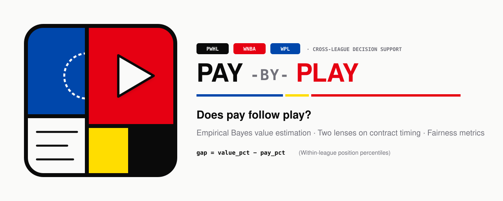
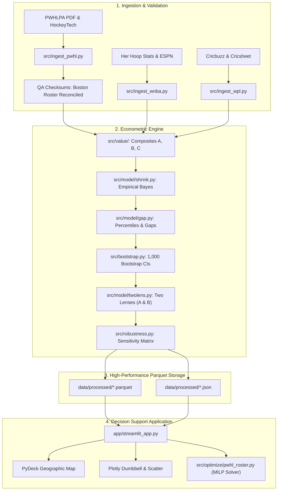

<p align="center">
  
</p>

<p align="center">
  <a href="https://www.python.org/downloads/"></a>
  <a href="https://streamlit.io/"></a>
  <a href="https://github.com/Trie-hard/Pay-by-Play"></a>
  <a href="https://github.com/Trie-hard/Pay-by-Play"></a>
  <a href="scripts/validate.py"></a>
  <a href="LICENSE"></a>
</p>

<h3 align="center">
  <em>Does pay follow play, and does the pay structure change the answer?</em>
</h3>

<p align="center">
  <strong>Cross-league econometrics, Empirical Bayes shrinkage, bootstrap inference, and interactive decision support across women's professional sports leagues.</strong>
</p>

---

## 📌 Table of Contents

- [Overview & Research Motivation](#-overview--research-motivation)
- [Key Findings & Mechanism Scorecard](#-key-findings--mechanism-scorecard)
- [Econometric & Statistical Methodology](#-econometric--statistical-methodology)
  - [The Two-Lens Framework](#1-the-two-lens-framework)
  - [Empirical Bayes Shrinkage](#2-empirical-bayes-shrinkage)
  - [Bootstrap Confidence & Confident Bargains](#3-bootstrap-confidence--confident-bargains)
  - [Pre-Registered Value Composites & Sensitivity](#4-pre-registered-value-composites--sensitivity)
- [Interactive Streamlit Decision-Support App](#-interactive-streamlit-decision-support-app)
- [System Architecture & Pipeline](#-system-architecture--pipeline)
- [Data Sources & Provenance](#-data-sources--provenance)
- [Quick Start & Developer Setup](#-quick-start--developer-setup)
- [Validation & Quality Assurance](#-validation--quality-assurance)
- [De Stijl Brand Identity System](#-de-stijl-brand-identity-system)
- [Repository Layout](#-repository-layout)
- [Ethical Framing & Analytical Scope](#-ethical-framing--analytical-scope)
- [Deployment & Links](#-deployment--links)

---

## 🔍 Overview & Research Motivation

Women's professional sports represent the most dynamic frontier in sports business, yet they feature drastically divergent labor compensation architectures:

1. **PWHL (Professional Women's Hockey League)**: A centralized collective bargaining agreement operating with strict **team average salary bands** ($60,100 ± 10%) and full base salary transparency.
2. **WNBA (Women's National Basketball Association)**: A traditional **hard tiered salary cap** with fixed veteran and rookie scales.
3. **WPL (Women's Premier League - Cricket)**: A dynamic, high-stakes **open micro-auction** bidding mechanism.

**Pay-by-Play** provides an econometric framework and decision-support suite to evaluate how these compensation structures translate on-field production into financial compensation. Rather than producing punitive "overpaid" lists, the framework is ethically grounded to identify **confident bargains**—athletes whose surplus value warrants immediate raise consideration.

---

## 📊 Key Findings & Mechanism Scorecard

Our cross-league analysis quantifies within-league fairness (Spearman rank correlation $\rho$ between pay percentile and value percentile) and the **Misallocation Index** (the share of league payroll that would need to shift for pay shares to match production shares):

| League | Compensation Mechanism | Sample ($n$) | Within-League Fairness ($\rho$) | Misallocation Index | Confident Bargains (80% CI) | Core Takeaway |
| :--- | :--- | :---: | :---: | :---: | :---: | :--- |
| **PWHL** | Strict Average Salary Band | 194 | **0.60** | 61.8% | **53** | High rank alignment driven by base salary transparency and draft slot anchoring. |
| **WNBA** | Hard Tiered Salary Cap | 160 | **0.42** | 44.5% | **19** | Cap constraints and max-salary caps compress elite surplus value. |
| **WPL** | Open Dynamic Micro-Auction | 60 | **0.47** | — | — | High bidding volatility across specialized T20 match phases. |

### Pre-Registered Hypotheses

- **H1 (PWHL Draft Primacy)**: Among drafted rookies ($n=42$), draft pick order correlates with base salary at $\rho = -0.92$ ($p = 4.95 \times 10^{-18}$), far outpacing real-world production correlation ($\rho = 0.44$, $p = 0.0037$). Compensation remains heavily anchored to draft position.
- **H2 (WNBA Raise Determinants)**: Across $n=182$ WNBA salary progressions, prior-season value explains only **26.9%** of raise variance ($R^2 = 0.269$, $p = 6.4 \times 10^{-14}$). Over **73%** of raise variance is dictated by cap inflation, service tenure, and bargaining leverage rather than linear box-score surplus.

---

## 📐 Econometric & Statistical Methodology

```
Raw Stats + Logs                  Raw Salaries / Auction
       │                                   │
       ▼                                   ▼
Value Composite (A/B/C)            Financial Reconciliation
       │                               (Boston Checksum)
       ▼                                   │
Empirical Bayes Shrinkage                  │
(Within-position tau2, sigma2)             │
       │                                   │
       └──────────────┬────────────────────┘
                      ▼
        Within-Position Percentiles
           (value_pct, pay_pct)
                      │
                      ▼
               Surplus Gap Metric
             gap = value_pct - pay_pct
                      │
                      ▼
         1,000-Rep Bootstrap Resampling
         (80% CI: [ci_low, ci_high])
                      │
                      ▼
           Confirmed Confident Bargains
          (ci_low > 0 & min games met)
```

### 1. The Two-Lens Framework

Sports contracts are negotiated with imperfect foresight. Pay-by-Play decomposes compensation through two distinct evaluative lenses:

- **Lens A (Pay Rationality)**: Compares current compensation against **prior-season performance**. Evaluates whether the contract was economically rational at the moment of signing.
- **Lens B (Return on Investment)**: Compares current compensation against **current-season performance**. Evaluates the realized value generated by the contract in the active campaign.
- **Lens Delta ($\Delta = \text{Gap}_B - \text{Gap}_A$)**: Quantifies breakout outperformance ($\Delta > 0$) versus slump or injury discount ($\Delta < 0$).

### 2. Empirical Bayes Shrinkage

To prevent small-sample volatility (e.g., reserve players with outstanding per-minute box scores in limited appearances) from distorting league percentiles, observed performance is shrunk toward the position mean:

$$\widehat{V}_i = \mu_{\text{pos}} + B_i \cdot (V_{\text{obs}, i} - \mu_{\text{pos}})$$

Where the shrinkage weight $B_i$ reflects the ratio of true player variance ($\tau^2$) to total observed variance ($\tau^2 + \sigma^2 / n_i$):

$$B_i = \frac{\tau^2}{\tau^2 + \frac{\sigma^2}{\text{exposure}_i}}$$

Values are standardized via within-position $z$-scoring before Empirical Bayes smoothing.

### 3. Bootstrap Confidence & Confident Bargains

To distinguish genuine market inefficiency from statistical noise, the pipeline executes **1,000 block-bootstrap resamples** across player game logs to generate **80% confidence intervals** $[\text{ci\_low}, \text{ci\_high}]$ for every player's surplus gap:

$$\text{gap}_i = \text{value\_pct}_i - \text{pay\_pct}_i$$

A player is designated as a **Confident Bargain** if and only if:
1. The 80% bootstrap confidence interval is strictly positive ($\text{ci\_low} > 0$).
2. The player satisfies the regular-appearance threshold ($\ge 10$ games for PWHL, $\ge 15$ games for WNBA, $\ge 60$ balls for WPL).
3. No blocking data-integrity flags are triggered.

### 4. Pre-Registered Value Composites & Sensitivity

All value functions are pre-registered in [`config/leagues.yaml`](config/leagues.yaml) and tested against three alternative specifications to verify that findings are robust:

| League | Definition A (Primary) | Definition B (Impact / Plus-Minus) | Definition C (Sensitivity / Weight) |
| :--- | :--- | :--- | :--- |
| **PWHL** | `box_score_per_game` (G, A, SOG, PIM) | `box_score_plus_on_ice_share` (+/- differential) | `position_weight_sensitivity` |
| **WNBA** | `per_minute_box_composite` (PTS, REB, AST, BLK, STL) | `box_plus_wehoop_impact` (net rating / impact) | `minutes_weighted_robust` |
| **WPL** | `phase_runs_added` (T20 powerplay, middle, death) | `phase_runs_plus_wicket_value` | `career_shrunk_phase_value` |

---

## 🖥️ Interactive Streamlit Decision-Support App

The repository includes a production-grade Streamlit application (`app/streamlit_app.py`) built with an asymmetric De Stijl modernist UI.

The app features seven purpose-built analytical tabs:

1. 🏛️ **Home**: Visual executive brief, research thesis, core econometric glossary, and brand narrative.
2. 🏆 **Scoreboard**: High-level cross-league mechanism comparison, pre-registered hypothesis test cards (H1 and H2), and value definition robustness checks.
3. 🗺️ **Explorer**: Interactive scatter plot of Pay Percentile vs. Value Percentile, complete with 4-quadrant shaded bargain/overpaid regions, interactive PyDeck city/market geographic filters, and confident bargain highlighting.
4. 🎯 **Raise Radar**: Lollipop dumbbell visualizations contrasting player pay percentiles against value percentiles, complete with bootstrap confidence intervals and sorted raise candidates.
5. 🔍 **Two Lenses**: Lens A vs. Lens B distribution histograms and breakout tables, identifying players whose in-season growth outstripped their historical pay baselines.
6. 🧮 **Roster Lab**: Mixed-Integer Linear Programming (MILP) solver utilizing **HiGHS** and **PuLP** to optimize PWHL rosters under the CBA average salary band ($60,100 ± 10%), including intelligent roster swap recommendations.
7. 📖 **Methods**: Formal econometric definitions, mathematical derivations, data provenance summaries, and transparency notes.

---

## 🏗️ System Architecture & Pipeline



---

## 📦 Data Sources & Provenance

| League | Compensation Data Source | On-Field Performance Source | Reconciliation Checksum |
| :--- | :--- | :--- | :--- |
| **PWHL** | [PWHLPA Official Salary Guide PDF](https://www.pwhlpa.com/salary-guide) (parsed to CSV via `pdfplumber`) | HockeyTech official game logs via `sportsdataverse.pwhl` | **Boston Team Total**: $1,436,173.50 across exactly 25 contracts |
| **WNBA** | [Her Hoop Stats](https://herhoopstats.com/salary-cap-sheet/wnba/players/salary_2026/stats_2025/) 2026 cap hit & salary sheets | ESPN official box scores via `sportsdataverse.wnba` | Verified roster match against wehoop / ESPN rosters |
| **WPL** | Cricbuzz 2026 official auction records & retained rosters | Cricsheet ball-by-ball event database (`wpl_json.zip`) | 60 matched regular players with $>60$ balls faced/bowled |

> [!NOTE]
> All processed Parquet and JSON files are checked directly into [`data/processed/`](data/processed/). The web app can be launched immediately without performing full external web scrapes.

---

## 🚀 Quick Start & Developer Setup

### Prerequisites

- **Python 3.10+** (Python 3.12 recommended)
- `git`

### 1. Clone & Set Up Virtual Environment

**Windows (PowerShell):**
```powershell
git clone https://github.com/Trie-hard/Pay-by-Play.git
cd Pay-by-Play

py -3.12 -m venv .venv
.venv\Scripts\activate
pip install -r requirements.txt
```

**macOS / Linux (Bash):**
```bash
git clone https://github.com/Trie-hard/Pay-by-Play.git
cd Pay-by-Play

python3 -m venv .venv
source .venv/bin/activate
pip install -r requirements.txt
```

### 2. Execute Data Pipeline & Run Validation Suite

```bash
# Optional: Fetch fresh raw data from external APIs
python scripts/fetch_data.py

# Run the complete econometric pipeline
python -m src.pipeline

# Execute automated quality and verification suite
python scripts/validate.py
```

### 3. Launch the Streamlit App

```bash
streamlit run app/streamlit_app.py
```

Navigate to `http://localhost:8501` in your browser.

### 4. Makefile Shortcuts

If `make` is installed on your system:
```bash
make install     # Install requirements
make pipeline    # Run end-to-end econometric pipeline
make validate    # Execute test suite
make app         # Launch Streamlit app
```

---

## 🧪 Validation & Quality Assurance

Our test suite in [`scripts/validate.py`](scripts/validate.py) enforces three non-negotiable verification gates:

```
[PASS] Boston Payroll Checksum: $1,436,173.50 across exactly 25 contracts
[PASS] Data Volume & Coverage: PWHL (194 rows, >95% pay coverage), WNBA (160 rows)
[PASS] Placebo Pay Shuffle Test: Real Spearman rho (0.598) vs. Permuted mean (|rho| = 0.053)
```

1. **Deterministic Financial Checksum**: Confirms that parsed base salaries exactly match disclosed team payroll benchmarks to the cent.
2. **Coverage & Completeness**: Asserts minimum regular thresholds and guarantees that missing data flags are appropriately logged.
3. **Placebo Pay Permutation Test**: Shuffles pay ranks randomly 20 times across player observations. Proves that real within-league fairness ($\rho = 0.598$) is statistically indistinguishable from zero in randomized noise ($\bar{\rho}_{\text{placebo}} = 0.053$).

---

## 🎨 De Stijl Brand Identity System

Pay-by-Play’s visual design marries rigorous sports data with Dutch **De Stijl / Bauhaus Modernism** (pioneered by Piet Mondrian and Gerrit Rietveld), using rectilinear structural framing and primary color tokens:

<p align="center">
  
</p>

| Token | Hex Code | Visual & Econometric Meaning |
| :--- | :--- | :--- |
| **De Stijl Blue** | `#0047AB` | **Pay / Contract Stability**: Disclosed compensation, baseline salary guides, and payroll grounding. |
| **De Stijl Red** | `#E60012` | **Play / Athletic Momentum**: On-field production, box-score impact, and game-log output. |
| **Canary Yellow** | `#FFDD00` | **The Value Gap**: The surplus metric ($gap = value\_pct - pay\_pct$), highlighting confident bargains. |
| **Structural Ink** | `#0A0A0A` | **Grid Integrity**: Rectilinear structural boundaries, tabular alignment, and mathematical honesty. |
| **Paper White** | `#FAFAF9` | **Canvas Ground**: High-contrast, glare-free clean background. |

For full brand rules, font pairings, and vector asset guidelines, see [`docs/BRAND_GUIDELINES.md`](docs/BRAND_GUIDELINES.md) and [`docs/Pay_By_Play_Brand_Identity.pdf`](docs/Pay_By_Play_Brand_Identity.pdf).

---

## 📁 Repository Layout

```text
├── .streamlit/
│   └── config.toml                  # De Stijl theme tokens & app configurations
├── app/
│   ├── brand.py                     # Brand tokens, colors, and asset references
│   ├── charts.py                    # Plotly chart generators (quadrant scatter, radar)
│   ├── chrome.py                    # Modernist navigation chrome & scoreboard cards
│   ├── streamlit_app.py             # Main 7-tab Streamlit application
│   ├── team_geo.py                  # PyDeck interactive geographic city maps
│   └── theme.py                     # App theme utilities
├── assets/
│   ├── logo-mark.svg                # Signature De Stijl primary logo mark
│   ├── logo-wordmark.svg            # Retina header banner for README and decks
│   ├── logo-icon.svg                # High-contrast square app icon / favicon
│   └── logo-icon-dark.svg           # Slate-calibrated dark mode variant
├── config/
│   └── leagues.yaml                 # Pre-registered league constants & thresholds
├── data/
│   ├── raw/                         # Raw game logs, salary guides, and auction CSVs
│   └── processed/                   # Production Parquets and analytical JSONs
├── docs/
│   ├── BRAND_GUIDELINES.md          # Comprehensive brand specification document
│   ├── Pay_By_Play_Brand_Identity.pdf # Rendered PDF brand showcase
│   └── Pay_By_Play_Brand_Identity.html # Interactive HTML brand guide
├── notebooks/
│   └── validation.ipynb             # Interactive Jupyter validation notebook
├── scripts/
│   ├── fetch_data.py                # External data extraction runner
│   ├── validate.py                  # Three-gate verification and checksum script
│   └── export_logo_png.py           # High-resolution PNG asset generator
├── src/
│   ├── fetch/                       # Scrapers and API wrappers (HockeyTech, HHS)
│   ├── model/
│   │   ├── gap.py                   # Percentile rankings and gap metrics
│   │   ├── metrics.py               # Spearman fairness, misallocation index, placebo test
│   │   ├── shrink.py                # Empirical Bayes shrinkage estimator
│   │   └── twolens.py               # Lens A vs Lens B delta integration
│   ├── optimize/
│   │   └── pwhl_roster.py           # MILP PWHL roster optimizer (PuLP / HiGHS)
│   ├── qa/
│   │   └── checksums.py             # Team payroll checksum reconciliation
│   ├── value/                       # Pre-registered sport-specific composites
│   │   ├── pwhl.py                  # Hockey value definitions (A, B, C)
│   │   ├── wnba.py                  # Basketball value definitions (A, B, C)
│   │   └── wpl.py                   # Cricket phase value definitions (A, B, C)
│   ├── analytics.py                 # Hypothesis test runners (H1, H2, WPL)
│   ├── bootstrap.py                 # 1,000-rep bootstrap confidence interval engine
│   ├── pipeline.py                  # End-to-end data orchestration pipeline
│   └── robustness.py                # Definition sensitivity analysis
├── definitions.md                   # Formal econometric terminology glossary
├── DEPLOY.md                        # Streamlit Community Cloud deployment guide
├── Makefile                         # Convenient workflow execution targets
└── requirements.txt                 # Pinned project dependencies
```

---

## ⚖️ Ethical Framing & Analytical Scope

- **Constructive Framing**: Findings are explicitly framed around identifying athletes who **deserve a raise** (*Confident Bargains*), rather than stigmatizing players as "overpaid."
- **Disclosed Base Salary Scope**: For the PWHL, figures reflect base salary as disclosed in the PWHLPA guide; bonuses, housing stipends, and non-wage benefits are excluded. Consequently, estimated gaps represent a lower bound on compensation disparities.
- **Within-League Evaluation Only**: Fairness and misallocation are calculated strictly as **within-league, within-position rank percentiles**. We do not make cross-currency dollar comparisons between leagues with divergent commercial maturity.
- **Excluded Leagues (NWSL)**: The NWSL was intentionally excluded from league-wide econometric rankings because public compensation disclosure is limited to an unrepresentative subset of players. PWHL’s published base salary structure serves as the model of transparency.

---

## 🚀 Deployment & Links

- **Streamlit Community Cloud**: The application is pre-configured for instant zero-fetch deployment via [DEPLOY.md](DEPLOY.md).
- **Definitions & Glossary**: See [definitions.md](definitions.md) for mathematical formulas and field descriptions.
- **Brand Identity**: See [docs/BRAND_GUIDELINES.md](docs/BRAND_GUIDELINES.md) and [docs/Pay_By_Play_Brand_Identity.pdf](docs/Pay_By_Play_Brand_Identity.pdf).

---

<p align="center">
  <sub>Built for the AQX Bowl. Built with mathematical rigor, ethical framing, and De Stijl modernism.</sub>
</p>
